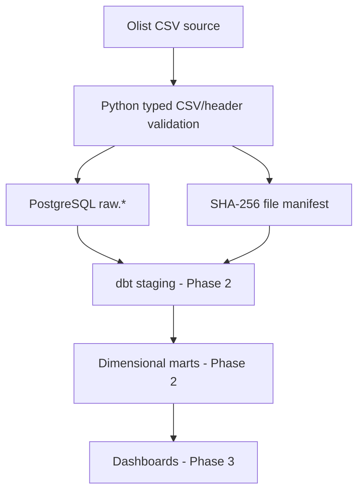

# Architecture

Raw columns retain original text values. Each file is copied in a database transaction with an audit manifest. Same-content reruns are skipped based on SHA-256. This is an append-only raw store: effective-version merging is future work.

Do not directly join order items and payments: both have multiple records per order and create a fanout. In the next milestone, aggregate to compatible grains or use separate fact tables.